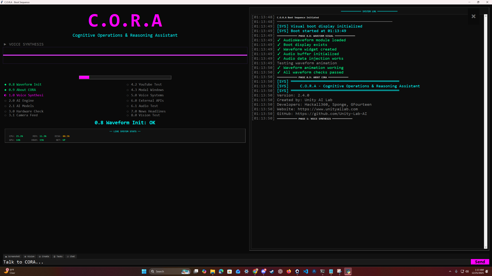

# C.O.R.A

```
  ================================================================
    ____   ___   ____      _
   / ___| / _ \ |  _ \    / \
  | |    | | | || |_) |  / _ \
  | |___ | |_| ||  _ <  / ___ \
   \____| \___/ |_| \_\/_/   \_\

  Cognitive Operations & Reasoning Assistant
  ================================================================
  Version: 3.0.0
  Unity AI Lab
  Website: https://www.unityailab.com
  GitHub: https://github.com/Unity-Lab-AI
  Contact: unityailabcontact@gmail.com
  Creators: Hackall360, Sponge, GFourteen, Alfreddo
  ================================================================
```

**Version 3.0.0** | **73 Python files** | **Unity AI Lab 2026**

CORA is a local, voice-first desktop companion. Her brain is `unity-brain`, Unity AI Lab's own text LoRA (Qwen3.5-9B) running in Ollama; her voice is `unity-voice-v2`, the lab's own trained voice; her ears are faster-whisper on the GPU. She has 120 tools for tasks, reminders, calendar, memory, knowledge, the screen and the webcam, the web, files, apps and windows, media, code, git and email. She paints on her own local image engine (the same Stable Diffusion rig Unity's stream renders with): pictures from words, edits of any picture, webcam shots recreated with the face kept, every result in a viewer with Save As. Nothing leaves the machine except the web requests you ask her to make.



---

## Quick start

```
windows\start.bat        (Windows)  -> venv, bootstrap, boot sequence
linux/start.sh           (Linux/macOS)
CORA.bat                 (Windows, the same launcher at the root)
```

`stop.bat` / `stop.sh` end everything she started and unload her models from the GPU.

What the launcher does: finds Python 3.13 (or 3.12), creates `.venv`, installs `requirements.txt` when it changes, runs `scripts/bootstrap.py` (checks Ollama, pulls the configured models, upgrades yt-dlp, installs the Playwright browser, starts her voice sidecar), then runs `src/boot_sequence.py`.

Other doors into the same brain:

| Entry point | What it is |
|---|---|
| `src/boot_sequence.py` | The main app: boot display with waveform and live stats, the chat box, wake word, ambient awareness |
| `src/gui_launcher.py` | The full GUI (chat, tasks, knowledge, settings) |
| `src/cora.py` | The CLI; CLI verbs run directly, anything else goes to her |
| `services/stats_server.py` | Serves the web version locally with her voice and the configured models |

---

## Talking to her

- Type in the box on the boot display, or say **"Cora"** and then your request. "stop" or "quiet" cuts her off.
- Every message goes through one conversation loop (`ai/dispatcher.py`): the model picks tools, runs them, then speaks the result in her own voice with the emotion and delivery she chooses.
- Anything destructive (deleting, sending, running scripts) she asks you to confirm first.
- Ask "what can you do" and she reads her own tool catalog back.

Examples: "add a task to call the dentist, priority 2" / "what's overdue" / "remind me to stretch in 20 minutes" / "what's on my calendar" / "remember my plate is ..." / "what's on my screen" / "look at the camera, what am I holding" / "search for ..." / "open youtube" / "play lofi" / "what's the weather" / "git status" / "email karen saying hi" / "imagine a neon city at night" / "make that one a rainy night" / "make a picture of me as a vampire" / "save that to my desktop".

---

## What runs

| Part | What | Where |
|---|---|---|
| Brain | `unity-brain` (Qwen3.5-9B LoRA, native tool calling, vision) in Ollama; fallback `huihui_ai/qwen3-abliterated:8b` | `ai/settings.py`, `config/config.json` `models` |
| Loop | one dispatcher for every entry point; 115 tools as JSON-schema tools, relevance-ranked per message; confirmation gating; shared transcript with summary folding | `ai/dispatcher.py`, `ai/tools_registry.py`, `ai/history.py` |
| Voice | `unity-voice-v2` sidecar on 127.0.0.1:5123; `say(text, emotion, act)` from the brain goes straight to it | `voice/tts.py`, `voice/unity_voice.py` |
| Ears | faster-whisper (CUDA) for commands and the transcript stream; fuzzy wake word; optional openWakeWord model | `voice/stt.py`, `voice/wake_word.py` |
| Eyes | webcam through a timeout-guarded, host-agnostic camera layer; screenshots; the brain reads images itself | `services/camera.py`, `cora_tools/vision.py`, `cora_tools/screenshots.py` |
| Images | her own local image engine: Stable Diffusion (realistic-vision-v51) as a sidecar on the torch interpreter (127.0.0.1:5124); text to image, img2img edits, inpainting, camera recreations with the face kept (IP-Adapter); her own look for selfies from config (`image.selfie_look`); the viewer window has Save As / Open folder; `save_image` puts a picture where you say | `services/image_sidecar.py`, `cora_tools/image_gen.py`, `ui/image_viewer.py`, `config.json` `image` |
| Web | search (DuckDuckGo, Brave, Bing through a headless browser when the plain endpoints block), readable page fetch | `cora_tools/web.py` |
| Web page | served locally with her voice, the configured models and her image engine (`/image/generate`, pictures under `/images/` with a download link) | `services/stats_server.py`, `web/` |
| Boot | 10 phases with spoken status, daily briefing (calendar, overdue tasks, reminders), reminder checker | `src/boot_sequence.py` |
| Config | one file, one loader, atomic saves | `config/config.json`, `ai/config.py` |
| Logs | everything printed also lands in `data/logs/cora-YYYYMMDD.log` | `ai/log.py` |

---

## Boot sequence

| Phase | What happens |
|---|---|
| 0.x | Window, waveform, About (all four creators, spoken) |
| 1 | Her voice (sidecar health, test line) |
| 2 / 2.1 | Ollama and the configured models |
| 3 / 3.1 | Hardware stats; camera open, snapshot, vision, close (bounded) |
| 4 / 4.5 | Core tools; daily briefing spoken; reminder checker started |
| 5 | Ears: STT, echo filter, wake word |
| 6 / 7 | Weather, location, news |
| 8 / 9 | Vision check; her selfie rendered on her own engine and opened in the viewer (`boot.selfie`) |
| 10 | Summary, then she is listening |

Demo phases (YouTube, GitHub import, result popups) are off by default: `boot.demo_phases`, `boot.popups` in config. The process DPI awareness is pinned before the first window (`ui/dpi.py`), so a library import can no longer re-scale the display mid-boot.

---

## Web version

Served by `services/stats_server.py` on 127.0.0.1:11435. The page gets the launch token, the Ollama URL, the configured models and context size, the same system prompt as the desktop, and her voice through `/voice/say`. Opened without the local server it runs text only against a local Ollama.

---

## Requirements

- Python 3.13 (3.12 works), NVIDIA GPU recommended (16 GB fits the brain, the voice and whisper together)
- Ollama; the launcher pulls `unity-brain` and the fallback. `unity-brain` and `unity-voice-v2` are built in the lab's Backrooms repo (`models/unity-brain`, `models/unity-voice-v2`); the voice sidecar needs a Python with torch and misaki (the launcher finds one or you set `UNITY_VOICE_PYTHON`)
- mpv (optional, YouTube playback): extract into `tools/mpv/` or install with winget/choco/scoop
- Images: the `realistic-vision-v51.safetensors` checkpoint (`config.json` `image.checkpoint`) and a Python with torch + diffusers (the voice sidecar's interpreter works; auto-detected, or `CORA_IMAGE_PYTHON`). No key, nothing hosted.
- Optional key in `.env`: `GITHUB_TOKEN` (git features)

Install by hand:

```
py -3.13 -m venv .venv
.venv\Scripts\pip install -r requirements.txt
.venv\Scripts\python scripts\bootstrap.py
.venv\Scripts\python src\boot_sequence.py
```

---

## Project layout

```
C.O.R.A/
├── src/        boot_sequence.py (main), cora.py (CLI), gui_launcher.py (GUI)
├── ai/         dispatcher.py, tools_registry.py, history.py, ollama.py, settings.py, config.py, log.py
├── voice/      tts.py, unity_voice.py, stt.py, wake_word.py, converse.py, commands.py, ambient_awareness.py, emotion.py
├── ui/         boot_display.py, app.py, panels.py, camera_feed.py, image_viewer.py, code_editor.py, query_panel.py, ...
├── cora_tools/ tasks, calendar, reminders, memory, knowledge, files, system, windows, web, browser, media, code, git_ops, email_tool, image_gen, screenshots, vision, self_modify ...
├── services/   camera.py, image_sidecar.py, presence.py, stats_server.py, weather.py, location.py, cli_popup.py
├── scripts/    bootstrap.py
├── windows/    start.bat, stop.bat          linux/  start.sh, stop.sh
├── web/        index.html (served locally)
├── config/     config.json, system_prompt.txt, hotbar.json
├── data/       tasks, knowledge, history, logs, camera (untracked)
└── docs/       ARCHITECTURE, SKILL_TREE, ROADMAP, TODO, FINALIZED, NOW, SYSTEM_AUDIT
```

`cora_tools/` is source. `tools/` holds downloaded binaries only (mpv, ffmpeg).

---

## Documentation

| File | Purpose |
|---|---|
| [SETUP.md](SETUP.md) | Installation |
| [HOW_TO_USE.md](HOW_TO_USE.md) | Using her day to day |
| [docs/ARCHITECTURE.md](docs/ARCHITECTURE.md) | Architecture: current state first, the original design spec below it |
| [docs/SKILL_TREE.md](docs/SKILL_TREE.md) | Capabilities by domain |
| [docs/ROADMAP.md](docs/ROADMAP.md) | Milestones |
| [docs/SYSTEM_AUDIT_2026-10-14.md](docs/SYSTEM_AUDIT_2026-10-14.md) | The audit that drove version 3.0.0 |
| [READMEs/UserGuide.md](READMEs/UserGuide.md) | Full user docs |
| [READMEs/NerdReadme.md](READMEs/NerdReadme.md) | Developer docs |
| [READMEs/APIReference.md](READMEs/APIReference.md) | Module reference |
| [CHANGELOG.md](CHANGELOG.md) | What changed, by version |

---

## License

Unity AI Lab, 2025-2026. MIT (see `pyproject.toml`).

*C.O.R.A v3.0.0 - Cognitive Operations & Reasoning Assistant - built by Unity AI Lab*
